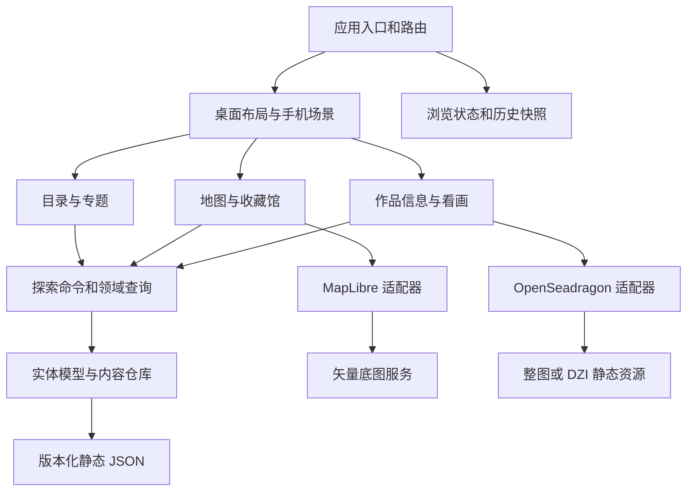

# 名画在哪里 第一版技术方案

日期：2026 年 10 月 31 日  
状态：首版已获许可并实现；双源底图已接通，正式版图验收待完成  
需求基线：需求稿 V1.1、最新原型、图像资源评估及唐寅测试清单

建议沿用工作区内现有 React 工程，采用 **React + TypeScript + Vite + Sass Modules**，以静态单页应用部署到 **GitHub Pages**。地图使用 MapLibre GL JS；原先推荐的 OpenFreeMap 因边界表达不满足本项目按中国规范展示的要求，撤回作为正式底图的推荐，改为世界概览及中国相关视野使用天地图，完整海外近景使用 OpenFreeMap。看画使用 OpenSeadragon，按资源清单选择普通整图或预生成 DZI 瓦片。内容以结构化 JSON 维护，第一版无需业务后端或数据库。

> 数据源更正（2026-10-31）：用户指出藏南边界与南海断续线问题。现有样式使用 OpenFreeMap `planet` 数据，国界图层过滤 `maritime = 1`，没有经过中国标准地图核对。应整体替换来源，不能用手绘补线或隐藏争议线代替核验。天地图官方文档提供 WMTS 的 `vec_w`、`cva_w`、`ibo_w` 等球面墨卡托服务，要求应用 Key；MapLibre 可保留并加载成图瓦片。国界、南海诸岛及断续线、台湾和相关岛屿、地名、各缩放级别及实际服务审图信息均需核对。青绿配色以不削弱必要内容为前提。第 7 节已更新为双源视野切换方案，OpenFreeMap 仅用于完全离开中国相关保护范围的海外近景。来源：[天地图文档](https://lbs.tianditu.gov.cn/server/MapService.html)、[标准地图说明](https://bzdt.tianditu.gov.cn/)、[自然资源部平台建设方案](https://app.www.gov.cn/govdata/gov/202403/13/512938/article.html)。

本方案只定义技术选型、模块职责、数据与交互规则、资源管线和验收方式，不包含应用实现。首轮开发主样本确定为唐寅 17 幅作品、34 张图片；已有离线转换结果作为工程依据，不能代替真机性能验收。

## 1 设计依据与范围

| 依据 | 用途 |
| --- | --- |
| [需求稿 V1.1](../../outputs/art-atlas-handoff/需求稿.md) | PC 与手机流程、地图分级、数据口径和验收基线 |
| [图像资源评估](../../outputs/art-atlas-handoff/图像资源评估.md) | 20 MB 限制、按需瓦片、独立局部和内存控制 |
| [唐寅测试清单](../../outputs/art-atlas-handoff/test-data/tang-yin/manifest.json) | 17 幅作品与 34 张整图、局部资源的稳定对应关系 |
| [原型目录](../../outputs/art-atlas-handoff/prototypes) | 布局、颜色、透明头部与控件比例 |
| [指定 Logo](../../outputs/art-atlas-handoff/assets/logo-pearl-cat.png) | 唯一品牌图源，保留透明通道与角色完整性 |
| [现有工程](../) | 工具链、已整理内容与部分可复用逻辑 |

最新 ZIP 已检查：包含 V1.1、图像资源评估和唐寅清单，压缩数据完整性检查通过。交接包不包含约 589.75 MB 的来源图片；本机来源目录存在，后续处理仍须逐文件核对清单、路径和 SHA-256。

第一版覆盖中国、外国、专题三个入口，画家与专题分布，地图馆藏展开，作品详情，高清浏览，手机横竖屏与返回恢复，以及基础异常和键盘操作。账号、收藏体系、评论、复杂筛选、旅游路线、实时展览和运营后台不进入本版。

“部署在 GitHub”在本方案中按“源码托管 GitHub，网页发布 GitHub Pages”设计。仓库名称、所属账号和域名在发布配置阶段补齐，不影响本轮架构设计。

## 2 现有工程与改造边界

现有工程已使用 React 19、TypeScript、Vite 8、Vitest 和 npm，Node 版本文件为 24；地图使用 Leaflet 1.9.4 与本地世界 GeoJSON，样式集中在全局 CSS。工程有既存未提交和已暂存的改动，后续实现必须先保留这些工作，不重置仓库或覆盖暂存区。

| 部分 | 处理建议 | 原因 |
| --- | --- | --- |
| React、TypeScript、Vite、npm 工具链 | 沿用，新增依赖锁定到 lockfile | 已满足静态部署，无需另建同类工程 |
| 达·芬奇作品 ID、来源、图像索引 | 核对后迁移，作为少量外国目录样本 | 已有整理成果；收藏事实与图片许可仍逐条保留 |
| 数据访问边界、纯函数测试思路 | 延续，调整实体和校验规则 | 方便将来扩充内容或替换数据来源 |
| 现有单一 museum 字段 | 迁移为独立 Holding 收藏关系 | 支持一画多馆、分卷与核验状态 |
| 当前 Leaflet 世界轮廓图 | 替换为矢量底图与新标记层 | 当前实现没有需求要求的逐级道路、建筑和地名细节 |
| 当前作品弹窗与放大开关 | 用作品信息组件和独立查看器重建 | 当前机制不具备连续缩放、长卷和瓦片生命周期 |
| 大筛选面板、收藏、图录横栏 | 从新版产品流程中移除 | 与新需求的简洁目录和地图结构不符 |
| 全局主题 CSS | 按组件迁移为 SCSS Modules | 控制样式作用域，减少联动修改 |
| 旧 Sites 发布配置 | 保留历史记录，新的部署流程指向 Pages | 本次目标为 GitHub，不复用旧站点身份发布 |

Leaflet 本身可以扩展瓦片能力；这里选择 MapLibre，是因为本项目需要逐图层配置颜色、地名、道路和建筑，并统一处理矢量地图展示。改造对象是地图实现，业务数据不绑定某一个 SDK。

可参考画廊的 [图片处理管线](../../漫览画廊/art-gallery/scripts/process-images.mjs)、[查看器](../../漫览画廊/art-gallery/src/viewer.ts) 与 [资源检查](../../漫览画廊/art-gallery/scripts/check-assets.mjs)。复用来源保护、DZI 校验、请求清理和视野恢复思路；调整其全量切片、统一 WebP 长边限制及全局 DPR 设置。画廊项目保持独立。

## 3 技术选型

| 层次 | 建议选型 | 使用范围 |
| --- | --- | --- |
| 页面与类型 | React、TypeScript strict | 组件、事件、数据契约 |
| 开发构建 | Vite、npm、Node 24 | 沿用现有基础，输出 dist 静态产物 |
| 样式 | Dart Sass + CSS Modules | 组件使用 `.module.scss`，少量全局基础样式 |
| 导航 | React Router 的 HashRouter | 统一深链接、浏览器历史和场景切换 |
| 浏览状态 | Zustand | 保存目录位置、地图和看画快照；按字段订阅 |
| 内容校验 | Zod + TypeScript 推导类型 | 构建时完整校验，运行时检查加载边界 |
| 地图引擎 | MapLibre GL JS | 矢量底图、视野和坐标投影 |
| 地图服务 | 天地图 + OpenFreeMap | 世界概览及中国相关视野使用天地图，完整海外近景使用 OpenFreeMap |
| 地点聚合 | Supercluster | 按馆聚合，另行计算作品 ID 并集 |
| 高清查看器 | OpenSeadragon | 普通 Image Tile Source 与 DZI 共用交互 |
| 离线图像处理 | Sharp | 产生缩略图、等比预览、受限高清图和按需 DZI |
| 图标 | 交接包中的 Lucide SVG | 通过统一 Icon 组件着色，保留来源与许可 |
| 验证 | Vitest、React Testing Library、Playwright、真机 | 分别验证领域逻辑、交互、完整流程和设备行为 |
| 发布 | GitHub Actions + GitHub Pages | 检查、构建、上传 Pages 产物、部署与回退 |

新增库在开始实现时选择与现有工具链兼容的稳定版本并锁定，避免将设计阶段的“最新版”作为长期约束。首版不引入 SSR、数据库、服务端鉴权、微前端或通用组件大套件；静态内容读取使用 fetch 和缓存即可。

Zustand 用于跨场景的细粒度订阅，避免将地图瞬时变化广播给整个组件树；Zod 负责对 JSON 的真实内容进行校验，不能用 TypeScript 类型断言代替。参考 [Zustand 官方仓库](https://github.com/pmndrs/zustand)、[Zod 数据校验](https://zod.dev/basics)。

## 4 模块架构与组件边界



组件按职责拆分。桌面和手机共用目录项、作品信息、地图和查看器能力，分别由布局组件组合；不复制两份业务查询和统计逻辑。

| 模块 | 主要组件或职责 | 对外边界 |
| --- | --- | --- |
| app | AppRouter、DesktopShell、CompactSceneShell | 装配模块、解释路由和设备布局 |
| catalog | CatalogTabs、PeriodAccordion、ArtistRow | 接收目录模型，发出选择事件 |
| topics | TopicList、TopicArtworkList | 策划顺序、专题层级和列表位置 |
| exploration | 切换范围、选择作品、定位、返回 | 协调导航、快照与地图命令 |
| map | MapCanvas、VenueMarker、ClusterMarker、MapControls | 接收场馆视图模型，输出用户意图 |
| venues | VenueArtworkList、VenueLocation | 当前范围内作品和收藏地点 |
| artworks | ArtworkDetails、ArtworkInfoPanel、SourceLinks | 地图与看画共用信息浮层，按场景控制放大入口 |
| viewer | ArtworkViewer、ViewerToolbar、DetailImagePicker | 图像源选择、缩放、局部切换、错误和清理 |
| platform | 布局识别、方向控制、可见性与安全区 | 封装浏览器差异 |
| shared | IconButton、AsyncImage、ErrorState、FocusReturn | 通用显示与可访问性，不持有业务状态 |

建议目录如下。它是未来实现结构，本轮不创建这些源码文件。

```text
达·芬奇名画地图/
  src/
    app/                  路由、布局、模块装配
    application/          探索命令、导航规则、快照管理
    domain/               实体 schema、计数与范围查询等纯逻辑
    features/
      catalog/ topics/ map/ venues/ artworks/ viewer/
    infrastructure/       静态内容仓库、地图及图像 SDK 适配器
    platform/             方向、布局能力、浏览器兼容
    shared/ui/            通用组件，每个组件就近放置 module.scss
    styles/               tokens、基础样式、mixins、vendor 样式边界
  content/                编辑用的结构化内容与公开资源清单
  public/media/           可部署的缩略图、高清图、DZI
  public/brand/           指定 Logo 和同源 favicon
  scripts/               内容校验、图像处理、资源检查
  tests/                  领域与流程测试；合成边界数据不参与发布
  docs/                   本方案、内容维护、发布和验收记录
  .github/workflows/      检查与 Pages 发布流程
```

依赖从 app/application 指向领域与功能模块。功能模块之间通过数据和事件协作，不互相读取内部状态；domain 不引用 React、DOM、MapLibre 或 OpenSeadragon。地图与查看器实例存于适配器内部 ref，不进入可序列化状态仓库。

适配器只提供本项目需要的创建、打开、定位、捕获状态、恢复状态、销毁等操作，不提前设计覆盖所有 SDK 的通用框架。第三方地图样式、图片源格式和 URL 解析集中管理。

## 5 页面导航与状态恢复

### 5.1 路由与显示方式

采用 HashRouter，页面位置放在 URL 的 hash 中，刷新具体作品时仍请求 Pages 的入口文件，无需服务器重写。代价是 URL 包含 `#`，且逐作品搜索引擎收录能力有限；首版优先保证可分享和可靠刷新。参考 [HashRouter 官方说明](https://reactrouter.com/api/declarative-routers/HashRouter)。

| 路由示意 | 手机显示 | PC 显示 |
| --- | --- | --- |
| `/#/catalog/china`、`foreign`、`topics` | 全屏目录 | 左栏目录与当前地图 |
| `/#/topics/:topicId` | 专题作品列表 | 左栏专题作品与地图 |
| `/#/map?scope=artist:tang-yin` | 全屏地图 | 当前目录与地图 |
| `/#/map?scope=…&venue=:venueId` | 地图居中并展开该馆作品 | 地图居中并展开该馆作品 |
| `/#/artworks/:artworkId?scope=…` | 地图上的作品信息浮层 | 地图中作品详情浮层 |
| `/#/artworks/:artworkId/view?scope=…` | 全屏看画 | 覆盖整个应用的看画模式 |
| `/#/artworks/:artworkId/view/info?scope=…` | 保留画布，叠加信息浮层 | 保留画布，右侧信息浮层 |

`scope` 支持 artist、topic、category 三种类型；category 仅用于尚未选择对象时的分类整体分布。页面需要保持的 scope 随导航传递。所选作品、馆和图像局部使用稳定 ID；图像局部可用 `asset` 参数分享，不能改变作品 ID。

PC 专题点作品只定位、高亮并替换当前选择参数；点击地图缩略图才进入详情。手机地图点缩略图直接进入看画。布局差异由 application 的导航命令统一判断，地图组件只报告“点击作品”事件。

信息内容通过可选 `onView` 区分使用场景：地图中的信息浮层提供“放大欣赏”；看画中的信息没有此入口，预览图也不绑定点击行为。看画浮层关闭只返回原画布，保留缩放、位置、当前高清局部与馆点上下文。

地图与看画的信息浮层均不阻挡画布交互。画布的 pointerdown 捕获阶段自动收起浮层，但不取消或吞掉指针事件，保证同一次拖动继续生效；滚轮缩放同样收起。仅监听实际画布，浮层内容、馆点和控件保留自身行为。自动收起不抢回焦点；地图跳过这次路由变化的历史相机恢复，保留当前视野与拖动。通常返回原主场景的历史条目，直接打开的信息链接则替换为对应主场景。

点击博物馆圆点或馆名后，地图居中到真实馆点，定位到 9 级城市视图，并直接在地图上展开当前 scope 内的全部作品缩略图。取消独立馆藏列表；旧 `/venues/:venueId` 链接替换为带 `venue` 参数的地图链接。用户缩小至 8 级及以下时收起展开，保留单张代表作，不改变缩放手势和当前中心；同时移除 URL 的 `venue` 参数并替换当前历史条目。放大到 9 级及以上时，视野内未聚合的馆点自动展开，无需先点击；8～9 级之间保持原状态。看画后返回保留历史视野；“查看整体分布”清除指定馆点并恢复聚合视图。

首次进入手机为中国目录；PC 为中国目录加已收录中国作品整体分布。中国目录不限制作品收藏地的国家。旧 `?collection=leonardo#work=…` 和 `#work=…` 链接在路由初始化前转换为新路由，保留可识别的作品 ID。

### 5.2 状态所有权

| 状态 | 保存位置 | 规则 |
| --- | --- | --- |
| 当前场景、探索范围、作品与馆 ID | URL 为唯一事实来源 | 不再复制为第二套可独立修改的全局状态 |
| 各标签展开项、目录层级和滚动位置 | Zustand 浏览会话 | 按分类、专题、馆内列表 key 分别保存 |
| 地图中心、zoom、选中标记 | 按历史条目保存的地图快照 | 拖动结束和离开场景时保存，不逐帧更新 React |
| 看画焦点、缩放、全卷或局部 | 按历史条目和 asset ID 保存 | 存归一化图像焦点及图像缩放尺度，避免依赖旧容器像素 |
| 当前实际方向、全屏和布局模式 | 浏览器状态与 platform 模块 | 监听真实结果，不以点击按钮的意图冒充成功 |
| 请求、SDK 实例、事件处理器 | 模块内部 | 不写入 URL、sessionStorage 或全局数据 |

URL 确定“在看什么”，浏览会话确定“看到哪里”。目录标签变化只更新目录位置，已有 scope 不变；只有选择画家、专题或明确打开分类整体地图才改变 scope。

首次打开范围按数据适配，重新进入已有历史条目恢复快照。打开和关闭详情、图片加载完成、方向变化、侧栏折叠和普通 resize 不重新执行整体适配。地图 resize 只调整容器；必要时为浮层遮挡做最小平移，并保存打开浮层前的视野供关闭时恢复。

### 5.3 历史与返回

进入画家地图、专题二级、馆列表、作品详情、看画和信息子视图，使用 push 形成可返回节点。展开朝代、切换选中高亮和拖动视野不创建历史节点；路由规范化用 replace。

页面返回和 Escape 都调用同一个导航命令。有已知站内父条目时回退一层；直接打开深链接时，页面返回按钮跳到确定的父场景，避免盲目调用后退导致离站。浏览器后退和前进由 Router 驱动恢复，不再维护第二套会与浏览器冲突的导航栈。

列表滚动值在内容加载、布局完成后恢复；焦点回到原触发控件，若控件已不存在则回到对应列表标题。可选 sessionStorage 仅保存小型、带版本号的快照；存储不可用时仍满足同一浏览流程恢复，不承诺跨设备同步。

## 6 数据模型与内容维护

### 6.1 实体和关系

| 实体 | 主要字段 | 约束 |
| --- | --- | --- |
| Period | id、category、name、dateLabel、可选 start/end、order | 分类为中国或外国；显示年代不由数字强行拼接 |
| Artist | id、name、category、primaryPeriodId、periodIds、lifeLabel、countryLabel、order | 多风格关联；“约”“后”“不详”和作者归属说明保留 |
| Artwork | id、title、artistCredits、dateLabel、medium、description、primaryImageId、status、sources | 作者关系可表达传、合作、存疑；同名不同版本不合并 |
| Venue | id、name、branch、city、country、coordinates、coordinateSource | 经纬度采用 WGS84，经度在前；未知为 null |
| Holding | id、artworkId、venueId、partLabel、status、verifiedAt、sources | 多对多关系；永久收藏与借展分开 |
| Topic | id、title、description、orderedArtworkIds、status、order | 策划顺序独立于年代和地理位置；不发布空专题 |
| ImageAsset | id、artworkId、role、label、order、thumbnail、preview、delivery、sources | role 为 whole 或 detail，图像数量不等于作品数量 |

ImageAsset 的 delivery 采用明确区分的 image 与 dzi 两种结构。image 必须有可浏览 URL、宽高、字节数和格式；dzi 必须有 DZI 地址、交付尺寸、tileSize、overlap、瓦片数量与总字节数，整图下载地址可选。两种结构都保留来源校验值、处理规格、质量条件和署名。

原图绝对路径、原件清单与处理日志保留在本地维护资料，不输出到网页 JSON。公开数据只包含可公开的相对资源地址或 HTTPS URL、来源及使用信息。高清源在数据中叫“高清图”，经处理后的版本不标称原始扫描文件。

局部图可记录 parentWholeImageId 与可选定位区域；没有可靠配准时区域为空。UI 提供“全卷／局部”选择，不能伪造局部在全卷中的精准坐标，也不自动拼接为连续高清图。

### 6.2 计数与地点规则

探索范围先得到 Artwork ID 集合，再关联符合展示条件的 Holding 和 Venue。单馆数量取作品 ID 去重；聚合点取各馆作品集合的并集；专题总数取专题作品集合。假设同一作品分藏两个馆、另一作品只在其中一馆，则两馆可以显示 2 和 1，合并聚合点仍为 2。

多馆作品定位所有已知相关地点。无坐标的收藏关系仍显示在信息和列表中，注明地点待核实；一个范围完全无坐标时保持可浏览列表与地图状态，不创建虚构点。不从文件名推断馆藏，不把作品归类当作所在国家。

地图默认只使用已核验的收藏关系；临时借展仅作为带日期的资料说明，不替换收藏地，未知状态不参与定位。曾经核验但来源失效或位置发生争议的记录应撤回定位并保留说明，不能根据旧坐标继续声称现址准确。

收藏事实、版本与分卷口径由内容核验决定。17 张独立局部只关联原作，不增加画家、专题和地图的作品数。“十大传世之作”的正式选目和版本口径在发布前另行定稿，不用占位清单冒充已确认内容。

### 6.3 内容交付流程

编辑用 JSON 按实体分类存放；构建时校验并生成带内容版本的静态数据。首版先生成轻量目录索引和一个完整内容包：目录先显示，选择范围后再读取内容包并在内存缓存。达到规模瓶颈后再按专题或实体拆包，避免首版重复处理跨专题共享作品。

校验包括稳定 ID 唯一、外键有效、专题有序去重、公开内容完整、经纬度范围、来源字段、资源实际存在、DZI 结构和字节预算。正式构建只包含可发布内容；测试清单和未核验内容通过独立构建配置使用，不携带到生产站点。加载失败保留导航并允许重试；相同资源请求去重，切换范围后忽略过期响应。

新增画家或专题的常规操作应只有更新内容记录、关联资源、执行校验、提交内容变更，无需修改 React 组件或复制页面。

## 7 地图技术方案

2026-10-31 接入结果：浏览器端 Key 已实测成功。天地图巴黎、伦敦抽样点在 11、12、14 级返回纯色瓦片，北京对应级别有内容。按用户要求改成分视野双源，巴黎高倍率恢复街道细节，返回南海后使用天地图并保留断续线。以下为更新后的运行时方案；正式版图内容与审图信息仍待完整验收。

### 7.1 引擎和底图

MapLibre 承载天地图成图瓦片和 OpenFreeMap 矢量地图，由 `src/infrastructure/regionalBasemap.ts` 集中控制切换。zoom ≤ 5 的概览始终使用天地图；达到 5.5 且整个视野离开经度 67°—143°、纬度 -3°—59° 的进入缓冲后才使用 OpenFreeMap。回到经度 70°—140°、纬度 0°—56° 的保护范围立即切回天地图。矩形是保守的工程切换范围，不是行政边界，也不绘制在地图上；部分邻近地区也会使用天地图。

判断依据是整个可见范围，覆盖平移、缩放、跳转和 resize，处理跨 180° 经线的视野；不按画家国籍或目录分类决定来源。切换整体替换样式，保留相机和馆藏标记，不拼接两套国界。异步海外样式采用请求版本号，避免晚到响应覆盖已回到中国的视野，卸载时终止请求。参考 [MapLibre 文档](https://maplibre.org/maplibre-gl-js/docs/)、[OpenFreeMap 服务说明](https://openfreemap.org/)、[接入指南](https://openfreemap.org/quick_start/)。

海外自定义样式集中管理署名、glyph、sprite、中文地名回退与图层颜色，水面、陆地、道路和建筑分别设色，弱化无关 POI。天地图适配器位于 `src/infrastructure/tianditu.ts`，顺序加载 `vec_w`、`ibo_w`、`cva_w`（1—18 级、256 px PNG），保留官方配色、境界和注记，不使用滤镜或逐要素改色。地图署名随实际来源切换，Key 不传给 OpenFreeMap。

天地图必须使用浏览器端 Key，从 `.env.local` 的 `VITE_TIANDITU_KEY` 或构建环境读取。Key 会出现在客户端请求中，应配置平台提供的访问限制和独立生产 Key；GitHub Actions secret 不会让已发布网页里的 Key 保密。中国相关视野在服务失败时显示重试及作品入口，不自动退回 OpenFreeMap。

不将演示令牌或全球底图全集放入应用，不在浏览器里动态查询馆址。馆坐标随核验数据发布，避免新增地理编码费用和位置歧义。无 WebGL、底图失败或服务不可达时显示重试和同范围作品入口；这种降级不视为真实地图验收通过。

### 7.2 按馆聚合与渐进展示

每个明确 Venue 生成一个地理点，绑定当前 scope 内作品集合；Supercluster 只聚合馆点。引擎的 point_count 表示馆点数，不能直接显示为作品数。聚合点通过叶子馆 ID 求作品集合并集，并按内容版本、scope 和 cluster ID 缓存。参考 [Supercluster 的叶子与展开接口](https://github.com/mapbox/supercluster)。

| 层级 | 标记策略 | 地理信息策略 |
| --- | --- | --- |
| 世界或大洲 | 聚合点与去重作品数 | 海陆、国家、少量主要城市 |
| 国家或区域 | 单独馆点即展示一张缩略图；密集时继续聚合 | 区域、主要交通与城市 |
| 城市 | 一张约 60 px 缩略图与馆名数量胶囊 | 道路、河流和区域名称 |
| 点击馆点或放大到城市层级后 | 上方展开当前范围全部作品，手机横屏使用横向缩略图带；缩小至区域层级时收起 | 城市及周边位置，不自动进入街道视图 |

馆点点击定位与单馆作品定位统一采用 zoom 9；zoom ≥ 9 自动展开，zoom ≤ 8 收起，中间区间保持原状态以避免反复开合。两项阈值集中在 `src/features/map/venueZoom.ts`，便于继续校准；聚合与次级馆名的展示仍依据投影像素间距、屏幕尺寸及标记密度。自动展开只作用于未聚合馆点，聚合点保留计数和点击展开行为。

聚合按钮点击后展开到可分辨范围；若达到最大层级仍有多个同坐标馆，打开馆选择列表，不能继续无限放大。聚合位置是聚合示意；独立馆始终使用真实锚点，不为排版修改经纬度。

标记用受控的 DOM 按钮承载点击和键盘能力，通过 MapLibre Marker 定位，React portal 渲染内容。只挂载视口及小范围外延内的标记，按稳定 ID 复用。默认将可见 DOM 标记目标控制在约 80 个以内；超限先提高聚合程度、减少次级标签，不随意丢掉可访问的馆和作品。

底图标签避让与应用 DOM 标记避让是两件事。应用额外做屏幕位置检测：展开馆及选中标记优先，其余隐藏次级馆名；单独馆点保留代表作缩略图。缩略图和馆名始终是两个独立按钮。代表作先选当前作品，再按策划顺序。定位盒固定为 44 × 44 px，圆点居中；缩略图和馆名采用绝对定位，不能参与地理锚点计算。

### 7.3 视野与性能

仅“切换探索对象”和“查看整体分布”触发整体 fit。专题点单幅画则适配其所有收藏点；单点设置合适最大 zoom，零点保留视野，跨日期变更线地点按最小经度跨度处理。浮层安全边距纳入定位，署名不被控件遮挡。

地图 move 时让 SDK 更新投影，聚合和 React 状态在 moveend、zoomend 或合并调度后更新。内容范围不变时不重建索引。地图隐藏进入看画时取消交互并暂停不必要更新；手机只保留快照并释放不再需要的地图实例，返回时重建并恢复，避免长期同时保留两个重型渲染器。

## 8 唐寅资源策略与离线管线

### 8.1 已确定的样本分组

| 资源策略 | 作品 | 数量 |
| --- | --- | --- |
| DZI | 王蜀宫妓图、事茗图卷、桐阴清梦图、幽人燕坐图、墨梅图、陶谷赠词图 | 6 幅 |
| 普通整图 | 秋风纨扇图、落霞孤鹜图、骑驴思归图、葑田行犊图、山路松声图、李端端落籍图、华山图、观瀑图扇页 | 8 幅 |
| 全卷加独立高清局部 | 溪山渔隐图加 12 张局部，采莲图加 5 张局部 | 2 幅 |
| 低清降级 | 吹箫仕女图，423 × 800 | 1 幅 |

上述总计 17 幅作品，34 张图片。开发先使用这一批，不另行搜索替代样本。外国目录及两个专题导航使用少量已核验记录验证；未定稿的专题在开发数据中验证结构，正式发布仍受内容状态控制。

### 8.2 三种成本分别记录

| 指标 | 口径与处理 |
| --- | --- |
| 文件与下载体积 | 单张上线高清整图不超过 20,000,000 字节；缩略图、预览、瓦片分别统计 |
| 解码像素缓冲 | 以宽 × 高 × 4 估算 RGBA8 单份缓冲，不冒充浏览器内存峰值实测 |
| 绘制和缓存 | 另计可见瓦片、缓存、Canvas、GPU 和过渡画面；在真机确定预算 |

《事茗图卷》42,561 × 3,688 的 RGBA8 单份缓冲估算为 **627,859,872 字节，约 628 MB**。压缩 JPEG 的 **17.17 MB** 是另一项指标，不能据此允许手机默认整图解码。其评估 DZI 总量约 **25.12 MB**，若同时部署 JPEG 和 DZI，合计约 **42.28 MB**，不是“整套资源不超过 20 MB”。所有 MB 预算均用十进制字节，避免混入 MiB。

现有离线评估覆盖 6 个代表样本，实际生成 4 组 DZI，不等于已完成全部 6 幅推荐 DZI 的生产处理。其中《秋风纨扇图》切片是对照试验，生产策略仍为普通整图。离线编码速度、局部对照与浏览器真机表现分别记录。

### 8.3 资源生成流程

1. 从清单读取源文件，核对 SHA-256、尺寸、角色和来源。原件保留在现有来源目录，处理只写独立输出目录，不覆盖原件。
2. 生成地图和目录缩略图，长边约 256—320 px，目标不超过 100 KB。方形图从源图的策划焦点裁切，尤其不能把超长卷先缩成细条再放大。
3. 按需生成约 1280 px 长边的等比预览，目标 300 KB 内、常规上限 500 KB。低清或已有更小合适 JPEG 直接复用，不统一强制转码。
4. 评估高清交付尺寸和格式，先比较质量与编码，再考虑等比缩小；单张高清文件必须不超过 20,000,000 字节。记录最终尺寸、格式、色彩处理和源校验值。
5. 总像素超过 1600 万或长边超过 16,383 px，默认进入 DZI 评估；其他资源先使用普通图片源，若体积超过约 8 MB 或真机卡顿再调整。这些是工程起点，不是浏览器统一硬限制。
6. DZI 从源图或无损中间结果按已接受的交付尺寸生成：JPEG、512 px、重叠 1 px、4:4:4 色度采样，质量约 86—90 起调。避免 WebP 再 JPEG 的连续有损转码。
7. 生成资源清单并校验全部层级、数量、边缘尺寸和可解码性，统计瓦片总量、最大单片、原件与交付哈希，审核后将生产产物纳入发布资产。

《王蜀宫妓图》采用评估中的 6845 × 12694、Q86、约 17.40 MB 作为首轮候选交付规格；《事茗图卷》采用原尺寸 JPEG Q86、约 17.17 MB。这些候选须在生产资源检查与视觉验收中确认，不宣称为最优编码结果，也不能将缩小的前者标成完全保留原图细节。瓦片与受限高清母图使用同一交付尺寸，不暗中额外提供不受约束的原画层。

DZI 文件和瓦片是静态资源，无需在线图像服务。首版每幅金字塔以约 30 MB 为存储参考目标，超出时报告并评估，不能把它当成用户设定的硬限制或自动降低画质。参考 [Sharp 金字塔输出](https://sharp.pixelplumbing.com/api-output/#tile)。

### 8.4 生产资产与仓库

源码仓库提交可维护内容、处理参数、资源清单和首发可部署衍生资产；来源巨图、本机路径清单及评估中间文件不进入公开资源。DZI 作品默认部署缩略图、预览和瓦片，不重复部署只作处理依据的巨型高清整图。若确需下载功能，再显式加入受限高清文件并计入总量。

从干净克隆应能构建网站，CI 不依赖这台机器的绝对路径。图像重新生成属于单独内容处理步骤，输入可从已归档原件恢复；生产构建只校验已经纳入版本的资源。后续资产规模增长时，可将媒体移动到支持 HTTPS 与 CORS 的独立存储，页面继续留在 Pages，ImageAsset 的地址解析边界不变。

## 9 看画加载与生命周期

### 9.1 按场景加载

| 场景 | 允许请求的图像 |
| --- | --- |
| 目录和地图 | 当前可见条目缩略图 |
| PC 作品详情 | 等比例预览，按需请求 |
| 普通图看画 | 先复用预览，再加载一个高清整图 |
| DZI 看画 | 预览、DZI 描述及当前视野需要的层级瓦片 |
| 独立局部 | 用户选择后加载该局部源，未选局部不预取高清 |

OpenSeadragon 封装两种高清来源，用户不需要选择 image 或 dzi 技术格式。DZI 模式不先请求高清整图，也不在客户端把整张巨图解码后切片。参考 [普通图片源及大图性能说明](https://openseadragon.github.io/examples/tilesource-image/)、[DZI 支持](https://openseadragon.github.io/examples/tilesource-dzi/)。

首次打开先适应完整原作；放大以指针或双指触点为中心，保持比例。长卷可横向拖动，一键还原仍显示全卷。工具上的缩放百分比明确以适应全图为 100% 展示，内部保存图像尺度与焦点用于方向变化恢复，不把 SDK 内部 zoom 直接当作用户百分比。

《溪山渔隐图》和《采莲图》在同一看画场景中按需展示“全卷／局部”入口。PC 使用紧凑选择控件，手机通过图标打开选择列表，选择后回到单一画布；每个 asset 分别保留视野。还原只还原当前 asset，全卷入口明确可达。局部未经配准，不提供连续跨图平移或无缝缩放承诺。

### 9.2 资源控制

手机初始瓦片并发从 2—4 个开始，缓存解码估算目标从 32—64 MB 起调。以约 1.05 MB 的 512 px RGBA8 瓦片为参考，可将保留数量从约 24—48 片开始校准，为边缘、加载中和可见瓦片留余量。SDK 的瓦片数量上限不是总浏览器内存硬上限；GPU、Canvas 和解码实现仍须实测。

查看器最多一个实例。图像切换使用请求代次标记，旧回调不能覆盖新作品；取消可取消的请求、清理定时器、监听器、对象 URL 和 SDK 缓存。离开看画销毁实例，只保留轻量快照。打开信息浮层时同一个查看器保持可见和可操作，不添加遮罩或 inert；旋转或 resize 时仍正常更新画布尺寸。关闭浮层不重建查看器，也不重置缩放位置。高清内容可见后隐藏轻量预览，避免平移时透出原位置的预览。

不在全应用强制 DPR 为 1，先以清晰度和设备内存测试决定是否仅限制查看器绘制分辨率。方向变化读取新容器尺寸，恢复归一化焦点和图像尺度，应用边界约束；适应全图状态则重新适应完整原作。

失败时保留已有预览或低层瓦片，提供重试、返回和信息；不自动回退去下载解码更大的整图。单瓦片重试采用有限次数，避免持续请求。加载进度只有在能计算时显示百分比，否则使用普通加载提示。

## 10 响应式与方向控制

### 10.1 布局模式

采用桌面双区与紧凑单场景两种布局模式，再针对宽度、短边和方向调整各自布局。不能只靠 `width >= 768` 将横屏手机认成桌面。

初始规则：细指针且有 hover 的环境，在可用宽度达到约 1024 px 时允许桌面布局；主要为触控、短边小于约 768 px 的设备保持紧凑单场景，旋转不改变该结论。触控平板首版默认单场景；混合输入设备结合主要指针和现有会话模式，不能因接上鼠标、工具栏高度变化或一次 orientation 事件突变。规则由 platform 模块统一计算，折叠屏和分屏纳入验收后调整。

PC 侧栏参考 280 px，在 248—300 px 内调整，独立滚动；地图占剩余完整区域。信息采用约 348 px 的浮层。手机目录、地图和看画保持独立主场景，作品信息叠加在当前主场景上：竖屏底部浮层最高 46dvh，横屏右侧浮层宽度不超过 46vw；内容独立滚动，始终留出画布区域。

### 10.2 悬浮层与安全区

应用使用动态视口高度并提供兼容回退，地图和画布铺满容器。通过安全区 inset 放置按钮，不让导航占据独立内容行。地图头部使用约 62% 绢白背景，看画头部约 76% 墨绿背景，向下渐隐；标题和图标不随背景一起透明。

悬浮容器空白部分不接收指针事件，具体按钮恢复事件。地图和查看器画布分别控制触摸手势，目录与信息页保留正常纵向滚动。控件点击区不小于 44 × 44 CSS px，横屏安全区和底部系统手势区分别适配。

### 10.3 方向切换

方向按钮仅在用户点击后检测并调用 Fullscreen 与 Screen Orientation 能力。按平台需要先请求全屏，再请求目标方向；监听实际方向和 fullscreenchange 更新图标。失败显示“请旋转设备”，保持原场景和视野，不用 CSS 旋转假装成功。

方向锁由地图或看画的控制器持有。看画信息浮层沿用看画的锁；回到目录、专题或作品列表等独立场景时释放本应用发起的锁，并仅退出本应用发起的全屏。手动旋转与系统退出全屏走同一恢复逻辑。浏览器支持有限，必须按真实设备验证，参考 [ScreenOrientation.lock](https://developer.mozilla.org/en-US/docs/Web/API/ScreenOrientation/lock)。

## 11 Sass 与视觉维护

业务组件统一使用 `.module.scss`。Sass 负责变量组合、函数和 mixin，CSS Modules 负责局部类名；颜色等需要被运行时和地图共享的设计值保持单一来源。Vite 支持 SCSS 与 CSS Modules 组合，Sass 使用 `@use`、`@forward` 管理模块。参考 [Vite 样式支持](https://vite.dev/guide/features.html#css-pre-processors)、[Sass 模块机制](https://sass-lang.com/documentation/at-rules/use/)。

| 样式文件类型 | 职责 |
| --- | --- |
| tokens | 从配色基线定义语义颜色、字体、间距、圆角和层级；输出 CSS 自定义属性 |
| mixins | 安全区、焦点、文字省略等无独立业务含义的复用规则 |
| globals | reset、基础字体、根高度、可访问性基础，不放具体业务组件样式 |
| component.module.scss | 当前组件内部布局与状态 |
| vendor | MapLibre、OpenSeadragon 必要覆盖，限制在应用容器范围内 |

颜色保留 paper、ink、accent、sage、dark 等语义。以交接配色建立项目的语义 token JSON，构建时生成供 Sass 使用的 token partial；地图配置读取同一份 JSON，生成文件不手工修改。SCSS 嵌套原则上不超过 3 层，避免 ID 选择器、跨模块内部类名引用和随处使用 important。React 只为实时地图位置、数值尺度等动态计算写内联值，常规布局与视觉放入 SCSS。

品牌使用指定 PNG 原图，保持比例和透明区域；favicon 仅从同一来源导出。系统中文无衬线字体优先，不分发本机字体文件。组件定义普通、选中、焦点、禁用、加载和错误状态；选中项同时使用结构或图标提示，不只改变颜色。

## 12 异常与可访问性

| 情况 | 行为 |
| --- | --- |
| 目录或内容读取失败 | 保留应用骨架，提供重试；不将失败误显示为零作品 |
| 地图网络或 WebGL 失败 | 提供重试与同范围作品列表，图像和资料仍可查看 |
| 范围有作品但无坐标 | 显示作品列表和地点待核实提示，不添加虚构点 |
| 当前视野无标记 | 提供查看整体分布，不改变当前 scope |
| 缩略图失败 | 中性占位、作品名和馆名保留 |
| 高清或瓦片失败 | 保留轻量画面、返回、信息和重试，不请求更大原图 |
| 无可用高清 | 使用现有清晰度，说明图像条件并限制无意义放大 |
| 无效或过期深链接 | 显示找不到内容与返回目录，清除无效参数 |

PC 目录、聚合点、馆标记、浮层及查看器工具均可用键盘操作。紧凑缩略图和馆名使用独立可读名称。PC 临时详情采用非模态区域，允许继续操作地图；全屏看画隔离背景焦点，Escape 仅关闭当前最上层。关闭后恢复触发焦点，图标提供 aria-label，加载错误用克制的状态提示。

地图和画作本身无法充分表达的信息同时通过可访问列表与信息视图提供。减少动态效果偏好关闭或缩短飞行动画；纯文本来源链接与定位收藏馆操作分开，外部来源打开独立页面。

## 13 性能预算与验证方式

以下是实现目标，尚无网页实测结果。外部地图服务加载另行计时，不能用目录首屏快来掩盖地图不可用。

| 项目 | 首轮目标 |
| --- | --- |
| 基础入口 JS | gzip 约 250 KB 内，地图与查看器按需拆包 |
| 初始 CSS | gzip 约 60 KB 内，重型模块样式随模块加载 |
| 目录索引 | gzip 约 100 KB 内，内容包避免重复作品记录 |
| 地图或列表缩略图 | 每张目标 100 KB 内，仅加载可见项 |
| 详情预览 | 目标 300 KB 内，常规上限 500 KB |
| 高清整图 | 单文件不超过 20,000,000 字节 |
| DZI 存储 | 单独统计总量、数量和最大瓦片；约 30 MB 每幅为参考目标 |
| 手机瓦片 | 并发 2—4，缓存解码估算从 32—64 MB 起调 |
| 目录可操作 | 中档手机、约 10 Mbps 与 100 ms 延迟、冷缓存目标 2.5 秒内 |
| 地图首次可用 | 同测试条件目标 5 秒内显示可操作底图与首批标记，独立记录外部耗时 |
| 看画首个可见画面 | 同测试条件目标 2 秒内出现预览或低层级瓦片；不等于全部高清完成 |
| 交互 | 地图与画作连续拖动目标接近 60 fps；中档真机记录卡顿、长任务和峰值内存 |

性能测试至少覆盖《事茗图卷》《王蜀宫妓图》冷启动、持续平移、缩放、横竖屏往返及连续切换 10 次作品。记录设备型号、系统、浏览器、网络、交付尺寸、DPR、请求量与可取得的进程或浏览器内存指标。只看 JavaScript heap 无法代表图像与 GPU 总内存；iOS 无完整指标时记录工具限制和页面重载、黑屏等结果，不编造峰值。

布局稳定性、资源释放和状态恢复与速度同样验收。缓存目标不是内存上限承诺；若真机出现持续累积、崩溃或卡顿，调整缓存、并发和绘制分辨率，再决定是否降低交付尺寸。

## 14 GitHub Pages 部署方案

### 14.1 静态产物与路径

Pages 只承载构建后的 HTML、CSS、JS、JSON 与图像资源。默认以项目站点部署：`https://<账号>.github.io/<仓库>/`，Vite base 为 `/<仓库>/`；账号根站点或自定义域名使用 `/`。资源统一经 BASE_URL 或媒体地址解析器拼接，不能写死域名根路径。参考 [Vite 的 GitHub Pages 部署说明](https://vite.dev/guide/static-deploy.html#github-pages)。

DZI 描述及 `_files` 目录保持相对结构，校验所有层级在仓库子路径下可取；同样检查 JSON、Logo、favicon、动态 chunk 和 MapLibre worker。外部地图端点使用 HTTPS；跨域图像或 IIIF 仅在来源允许且 CORS 满足查看器要求时启用。默认生产图像使用经过许可核验的本地静态衍生资源，避免依赖临时下载链接。

### 14.2 发布流水线

PR 或开发分支只运行检查，不自动发布。发布流程在明确进入发布阶段后配置为目标分支触发或手动触发，依次完成：

1. 固定 Node 与 lockfile，使用 npm ci 安装依赖。
2. 内容与资源校验、类型检查、必要单元及流程测试。
3. 以目标 base 构建并检查静态包体积、深链接和资源路径。
4. 上传 Pages 静态产物，再由 deploy-pages 发布到 GitHub Pages 环境。
5. 访问正式入口及一条作品深链接，确认地图、普通图、DZI 和来源链接。

构建 job 使用最小读取权限，部署 job 才授予 Pages 与身份令牌所需权限；不向 fork 的检查暴露发布凭据。使用部署并发控制避免旧构建覆盖新版本。记录提交号和资源清单版本，回退通过重新部署上一已验证提交完成，不手改 dist。

本轮不创建仓库、设置 Actions、推送或部署。后续实施保留现有本地历史；是否完整上传旧历史，应先核对历史中的产物和大文件，再确定远程托管方式。

### 14.3 容量边界

GitHub 当前文档规定发布的 Pages 站点不超过 1 GB，带宽有每月 100 GB 的软限制；普通 Git 仓库阻止超过 100 MiB 的单文件。首版将静态发布包以 300 MB 为内部预警线，预留更新空间；超出时评估媒体外置，不默默继续向仓库塞来源巨图。参考 [Pages 限制](https://docs.github.com/en/pages/getting-started-with-github-pages/github-pages-limits)、[大文件限制](https://docs.github.com/en/repositories/working-with-files/managing-large-files/about-large-files-on-github)。

Git LFS 指针不能当作可直接浏览的 Pages 图片。来源备份、生产整图、瓦片与 Git 历史增长分别管理；DZI 控制一次浏览的下载量，不会自动减少全部资产存储量。

## 15 实施阶段与退出条件

以下工作均以用户许可开始编码为前提。顺序先验证地图和大图两项外部依赖，再按 PC 到手机推进。

| 阶段 | 主要工作 | 完成条件 |
| --- | --- | --- |
| 0 基线与技术验证 | 保留既有改动；验证真实底图、Pages 子路径、普通图与两幅大型样本 | 确认底图访问、DZI 路径及手机可用性，记录初测限制 |
| 1 结构与内容 | 目录模型、Holding、ImageAsset、Sass token、指定 Logo、数据迁移 | 唐寅 17 幅和少量外国样本可加载，34 张图正确关联 |
| 2 PC 核心 | 三类目录、专题二级、真实地图、按馆聚合、详情 | 选画家或专题到看作品的 PC 路径完整 |
| 3 高清浏览 | 普通图、6 幅 DZI 生产处理、全卷和局部、错误恢复 | 按场景请求资源，整图限制与瓦片校验通过 |
| 4 手机场景 | 独立场景、历史恢复、悬浮层、安全区、方向控制 | 竖横屏流程及能力不足降级通过真机检查 |
| 5 完整验收 | 领域边界、来源、键盘、异常、性能与正式内容核验 | 需求 V1.1 的清单逐项有结果和设备记录 |
| 6 GitHub 发布 | 配置目标仓库、Actions、Pages，部署验证与回退说明 | 正式 URL、深链接和两种图像模式验证通过 |

阶段 0 不替代正式验收；若首选底图在目标网络不可用，先解决提供商选择，不能把静态轮廓图作为最终地图交付。开发样本完成也不代表“十大传世之作”等专题已完成正式策划。

## 16 验收矩阵

| 验证层 | 重点用例 |
| --- | --- |
| 领域单元 | 多馆同一作品并集、同馆多作品、无坐标、专题顺序、空专题、年代不确定性 |
| 内容检查 | ID 与外键、17 幅对应 34 图、局部不计作品数、来源、公开资源无本机路径 |
| 图像管线 | 原件哈希不变、高清整图上限、DZI 层级和边缘、大小统计、长卷比例与色彩 |
| 组件交互 | 标签切换不改 scope、列表位置、两个标记按钮、焦点恢复、加载与错误 |
| PC 完整流程 | 目录 → 分布 → 馆列表或作品详情 → 看画 → 返回；专题点画只定位 |
| 手机完整流程 | 目录 → 地图 → 馆列表 → 看画 → 信息 → 连续返回，恢复各自位置 |
| 历史和直达 | 浏览器前进后退、页面返回、Escape、刷新深链接、旧链接迁移、无效 ID |
| 布局 | 1440×820、1024×768、390×844、844×390、窄屏和触控平板；尺寸为 CSS px |
| 真机 | iPhone Safari、Android Chrome；旋转、全屏拒绝、安全区、双指手势和内存 |
| 网络异常 | 底图失败、单图失败、缺瓦片、冷缓存慢网、旧响应晚到、无 WebGL |
| 发布 | 仓库子路径刷新、资源无 404、DZI 可见、外部署名正常、上一版本可回退 |

自动化浏览器适合稳定流程和失败注入；真实地图接入另做冒烟检查。自动化设备模拟不能替代真机方向锁、GPU 与内存测试。合成的多馆和异常数据只进入测试，公开站点不以虚构收藏事实凑覆盖率。

## 17 决策状态与后续输入

| 项目 | 当前状态 | 何时需要进一步确定 |
| --- | --- | --- |
| React、模块化、响应式、Sass、GitHub 部署 | 用户要求，已纳入 | 无需重新选择 |
| 指定 Logo 与需求 V1.1 | 确定基线 | 实现与视觉验收均按此执行 |
| 唐寅 17 幅、34 张、20 MB 与按需瓦片 | 确定开发基线 | 生产处理和真机验证时细化参数 |
| 沿用现有工程、MapLibre、OpenSeadragon、HashRouter 等 | 本方案建议 | 用户评审许可后实施 |
| 双源底图 | 已实现 | 中国相关视野及世界概览使用天地图；完整海外近景使用 OpenFreeMap，继续正式版图验收 |
| GitHub 账号、仓库名、域名与公开内容范围 | 尚未指定 | 配置正式发布前确定 |
| 首发画家范围、两个专题的正式清单 | 开发样本之外尚未定稿 | 正式内容发布前确定，不阻断组件开发 |
| 真机可用设备、缓存和绘制参数 | 待实测 | 不能用离线评估结论直接替代 |

本轮交付为这份设计文档。应用源码、依赖、资源处理和发布工作在获得用户许可后开始。
